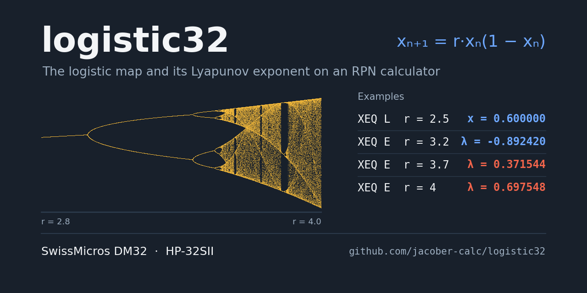
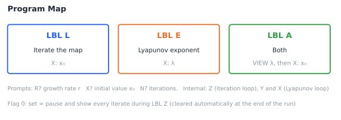
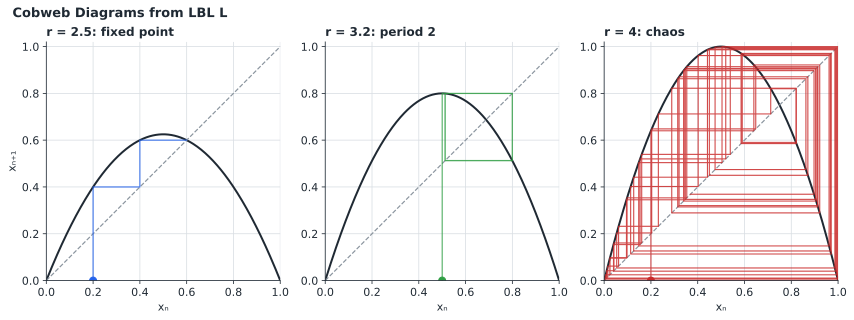
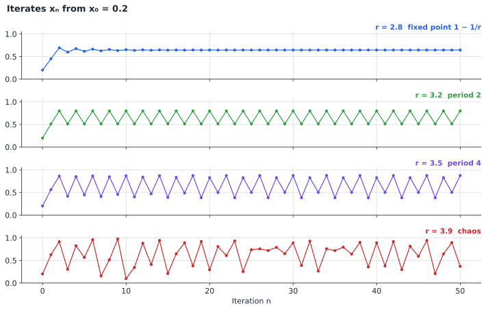
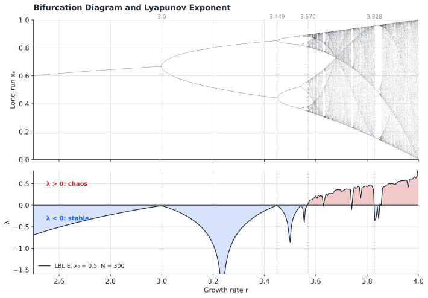
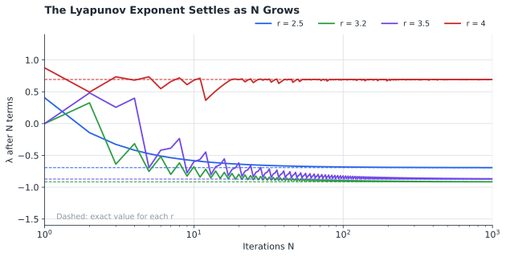
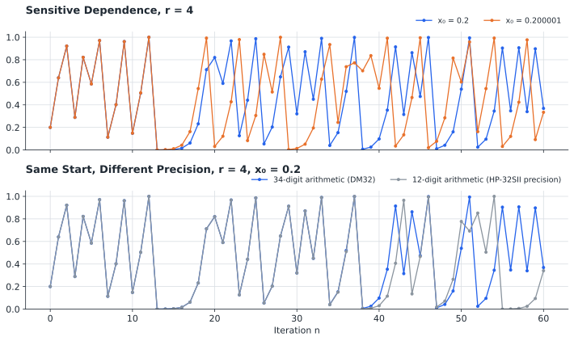

# logistic Statefile

## TABLE OF CONTENTS

1. [Introduction](#1-introduction)
2. [Theory of Operations](#2-theory-of-operations)
3. [Variable Definitions](#3-variable-definitions)
4. [Program Descriptions](#4-program-descriptions)
5. [Operating Instructions](#5-operating-instructions)
6. [Example Calculations](#6-example-calculations)
7. [Quick Reference](#7-quick-reference)
8. [Program Listing](#8-program-listing)

---

## 1. INTRODUCTION

This program suite explores the logistic map, the simplest equation known to produce chaos, on the SwissMicros DM32 calculator. It iterates the map from any starting value and growth rate, shows each iterate as it is calculated, and calculates the Lyapunov exponent, the number that tells an orderly orbit from a chaotic one.

### 1.1 Purpose

The program enables users to:

- Iterate the logistic map xₙ₊₁ = r·xₙ(1 − xₙ) any number of times
- Watch each iterate as it is calculated
- Observe fixed points, period-doubling cycles, and chaos
- Calculate the Lyapunov exponent for any growth rate and starting value
- Demonstrate sensitive dependence on initial conditions

### 1.2 System Requirements

SwissMicros DM32 calculator with RPN operating system. Program requires 77 program steps in 6 labels. Flag 0 selects whether each iterate is displayed (section 5.2). No equations, Global registers, or other Statefiles are used.

Every instruction in the program is also available on the HP-32SII, so the program can be keyed into an HP-32SII as listed. Results are the same for stable orbits; for chaotic orbits they differ after about 30 iterations because the HP-32SII works to 12 digits and the DM32 to 34 (section 2.5).

### 1.3 Install and Download

Copy **LOGISTIC.d32** to the `/STATE` folder of the DM32's internal USB disk, then load it from the calculator. Instructions are available [via the DM32 User Manual](https://technical.swissmicros.com/dm32/doc/dm32_user_manual.html#_saving_and_loading_a_state).

The Statefile is saved in FIX 6 display format.

---

## 2. THEORY OF OPERATIONS

### 2.1 Program Map



### 2.2 The Logistic Map

The logistic map is a simple model of a population that grows in proportion to its size but is limited by its environment:

```
xₙ₊₁ = r · xₙ · (1 − xₙ)
```

where xₙ is the population in generation n as a fraction of the maximum the environment can support (0 to 1), and r is the growth rate (0 to 4). The term r·xₙ is growth; the term (1 − xₙ) holds the population back as it nears the limit.

Each new value depends only on the last, so the map is easy to follow on paper. A cobweb diagram does this graphically: move up to the curve to find the next value, then across to the diagonal to make it the new starting point.



### 2.3 From Order to Chaos

As r increases, the long-run behaviour of the orbit changes:

| Growth rate r | Long-run behaviour |
|---------------|--------------------|
| 0 to 1 | Population dies out: xₙ → 0 |
| 1 to 3 | Settles to the fixed point 1 − 1/r |
| 3 to 3.449490 (1 + √6) | Alternates between two values (period 2) |
| 3.449490 to 3.544090 | Cycles through four values (period 4) |
| 3.544090 to 3.569946 | Period 8, 16, 32 … at ever closer values of r |
| 3.569946 to 4 | Chaos, broken by windows of order such as period 3 at 3.828427 (1 + √8) |
| 4 | Fully chaotic |



Plotting the long-run values of xₙ against r gives the bifurcation diagram (top). Each split is a period doubling; the doublings come faster and faster until chaos sets in.



### 2.4 The Lyapunov Exponent

The Lyapunov exponent λ measures how fast two nearby orbits move apart. If two orbits start a small distance δ apart, after n iterations they are about δ·e^(λn) apart. The slope of the map, f′(x) = r(1 − 2x), sets how much each step stretches or shrinks that distance, so LBL E averages its logarithm along the orbit:

```
λ = (1/N) × Σ ln|r(1 − 2xₖ)|      k = 0 to N − 1
```

| λ | Meaning |
|---|---------|
| Negative | Nearby orbits converge: a stable fixed point or cycle |
| Zero | A bifurcation point, where the behaviour is about to change |
| Positive | Nearby orbits separate exponentially: chaos |

The bottom half of the bifurcation chart shows λ from LBL E. It touches zero at each period doubling, and turns positive where the diagram turns chaotic.

The sum starts at the initial value x₀, so the first few terms reflect the orbit settling down rather than its long-run behaviour. Their effect shrinks as N grows:



**Superstable points.** When xₖ is exactly 0.5, the slope is zero and its logarithm is −∞. Lines Y11 and Y12 skip that term rather than stop with an error, so an orbit that lands exactly on 0.5 (for example r = 2 with x₀ = 0.5) returns a λ closer to zero than its true value.

### 2.5 Sensitive Dependence and Precision

In the chaotic range, a difference in the sixth decimal place of x₀ grows until the two orbits have nothing in common (top). At r = 4, λ = ln 2, so the difference doubles with each iteration and the orbit loses about 0.3 of a digit of accuracy per step.

The same applies to rounding. The DM32 calculates in decimal to 34 digits; the HP-32SII to 12. Started from the same x₀, the two agree for about 30 iterations at r = 4 and then separate (bottom). Neither is the "true" orbit beyond that point, but every DM32 gives the same result for the same inputs, so the examples in section 6 can be repeated exactly.



---

## 3. VARIABLE DEFINITIONS

| Variable | Description |
|----------|-------------|
| **R** | Growth rate r (0 to 4) |
| **X** | Initial value x₀ (0 to 1); unchanged by the programs |
| **N** | Number of iterations (whole number, 1 or greater) |
| **Y** | Current value xₙ; holds the final value after LBL L or LBL A |
| **i** | Loop counter for DSE (counts down from N) |
| **L** | Running sum of ln\|r(1 − 2x)\| (LBL E) |
| **S** | Lyapunov exponent λ = L ÷ N (LBL E) |

| Flag | Description |
|------|-------------|
| **0** | Set: pause and show each iterate in LBL Z. Cleared automatically at the end of the run |

---

## 4. PROGRAM DESCRIPTIONS

### 4.1 User Programs

#### LBL L - Logistic Map Iterator

- **Inputs:** Growth rate (R?), initial value (X?), iterations (N?)
- **Outputs (Stack display from top to bottom):**
  - T: Growth rate r
  - Z: Initial value x₀
  - Y: Iterations N
  - X: Final value xₙ

With Flag 0 set, each iterate x₁, x₂ … xₙ is shown for about 1 second as it is calculated.

#### LBL E - Lyapunov Exponent

- **Inputs:** As LBL L
- **Outputs (Stack display from top to bottom):**
  - T: Growth rate r
  - Z: Initial value x₀
  - Y: Iterations N
  - X: Lyapunov exponent λ

#### LBL A - Iterate and Lyapunov Exponent

- **Inputs:** As LBL L
- **Outputs:**
  - Display: Lyapunov exponent (S=)
  - After `[R/S]`, the stack holds the same results as LBL L: T: r, Z: x₀, Y: N, X: xₙ

LBL A runs LBL E, restarts the orbit from x₀, and runs it again through LBL Z. With Flag 0 set, the iterates are shown during the second pass only.

### 4.2 Internal Subroutines

- **LBL Z:** Iteration loop; returns r, x₀, N and xₙ on the stack and clears Flag 0
- **LBL Y:** Adds ln|r(1 − 2x)| to L for each iterate
- **LBL X:** Advances the orbit one step and ends the Lyapunov sum

---

## 5. OPERATING INSTRUCTIONS

### 5.1 Loading the Statefile

Load LOGISTIC from the Available States list (`[F4]`) or the File menu (section 1.3).

### 5.2 Showing Each Iterate (Flag 0)

- **Flag 0 clear** (default): the program runs without stopping and shows only the result.
- **Flag 0 set** (`[SF] [0]`): each iterate is shown for about 1 second. The 0 annunciator shows the flag is set.

LBL Z clears Flag 0 at the end of every run, so set it again before each run in which you want to watch the iterates. At about 1 second per iterate, use Flag 0 with small values of N. Press `[R/S]` to stop a running program.

### 5.3 Prompts

Each prompt shows the value currently stored in the variable. Press `[R/S]` to keep it, or key in a new value and press `[R/S]`. To repeat a calculation with only N changed, press `[R/S]` at the R? and X? prompts.

### 5.4 Iterating the Map

```
1. Press [XEQ] [L]
2. R? growth rate                   [R/S]
3. X? initial value                 [R/S]
4. N? number of iterations          [R/S]
```

### 5.5 Lyapunov Exponent

```
1. Press [XEQ] [E]
2. Answer the R?, X? and N? prompts as in section 5.4
```

### 5.6 Both Together

```
1. Press [XEQ] [A]
2. Answer the R?, X? and N? prompts as in section 5.4
3. Read the Lyapunov exponent (S=) and press [R/S]
```

---

## 6. EXAMPLE CALCULATIONS

Results are shown in FIX 6, the display format saved in the Statefile. All examples start with Flag 0 clear unless stated.

### 6.1 Fixed Point

**Problem:** A population starts at 20% of its limit with a growth rate of 2.5. Where does it settle after 20 generations?

**Solution:**
```
[XEQ] [L]
R?  2.5 [R/S]
X?  0.2 [R/S]
N?  20  [R/S]
```

**Results (displayed on screen from top to bottom):**

| Register | Value | Meaning |
|----------|-------|---------|
| T | 2.500000 | Growth rate r |
| Z | 0.200000 | Initial value x₀ |
| Y | 20.000000 | Iterations N |
| X | 0.600000 | Final value x₂₀ |

The fixed point is 1 − 1/r = 1 − 1/2.5 = 0.6. From x₀ = 0.2 the orbit reaches it exactly at x₂ (0.4, then 0.6).

### 6.2 Watching the Iterates

**Problem:** Show the first six iterates for r = 3.2, starting from x₀ = 0.5.

**Solution:**
```
[SF] [0]
[XEQ] [L]
R?  3.2 [R/S]
X?  0.5 [R/S]
N?  6   [R/S]
```

**Display:**

| Keys | Display | Description |
|------|---------|-------------|
| | 0.800000 | x₁ |
| | 0.512000 | x₂ |
| | 0.799539 | x₃ |
| | 0.512884 | x₄ |
| | 0.799469 | x₅ |
| | 0.513019 | x₆, final result in X |

The orbit settles into a cycle of two values. Flag 0 is now clear.

### 6.3 Period 2

**Problem:** Find the two values of the cycle in Example 6.2.

**Solution:**
```
[XEQ] [L]
R?  [R/S]
X?  [R/S]
N?  50 [R/S]                     0.513045
[XEQ] [L]
R?  [R/S]
X?  [R/S]
N?  51 [R/S]                     0.799455
```

**Expected Results:** x₅₀ = 0.513045 and x₅₁ = 0.799455. The orbit alternates between these two values.

### 6.4 Sensitive Dependence

**Problem:** At r = 4, compare 20 iterations from x₀ = 0.2 and from x₀ = 0.200001.

**Solution:**
```
[XEQ] [L]
R?  4        [R/S]
X?  0.2      [R/S]
N?  20       [R/S]               0.820014
[XEQ] [L]
R?  [R/S]
X?  0.200001 [R/S]
N?  [R/S]                        0.031369
```

**Expected Results:** x₂₀ = 0.820014 from x₀ = 0.2, but 0.031369 from x₀ = 0.200001. A starting difference of 0.000001 has grown to nearly the full range of the map.

### 6.5 Lyapunov Exponent, Stable Cycle

**Problem:** Calculate the Lyapunov exponent for r = 3.2 from x₀ = 0.5, first with 100 iterations, then with 1000.

**Solution:**
```
[XEQ] [E]
R?  3.2  [R/S]
X?  0.5  [R/S]
N?  100  [R/S]                   -0.892420
[XEQ] [E]
R?  [R/S]
X?  [R/S]
N?  1000 [R/S]                   -0.913904
```

**Expected Results:** λ = −0.892420 with N = 100 and −0.913904 with N = 1000. The negative value confirms a stable cycle. The exact value for the period-2 cycle is ½ ln 0.16 = −0.916291; the larger N reduces the effect of the opening iterates (section 2.4).

### 6.6 Lyapunov Exponent, Chaos

**Problem:** Calculate the Lyapunov exponent for r = 4 from x₀ = 0.2 with 50 iterations, and for r = 3.7 from x₀ = 0.5 with 100 iterations.

**Solution:**
```
[XEQ] [E]
R?  4   [R/S]
X?  0.2 [R/S]
N?  50  [R/S]                    0.697548
[XEQ] [E]
R?  3.7 [R/S]
X?  0.5 [R/S]
N?  100 [R/S]                    0.371544
```

**Expected Results:** λ = 0.697548 for r = 4 (exact value ln 2 = 0.693147) and λ = 0.371544 for r = 3.7. Both are positive: the orbits are chaotic.

For chaotic orbits, keep N to about 100 or fewer when comparing with these results. With larger N, λ still settles near the same value, but its last digits depend on the exact arithmetic (section 2.5).

### 6.7 Iterate and Lyapunov Exponent Together

**Problem:** For r = 3.5 and x₀ = 0.5, find the Lyapunov exponent and the value after 100 iterations.

**Solution:**
```
[XEQ] [A]
R?  3.5 [R/S]
X?  0.5 [R/S]
N?  100 [R/S]                    S=-0.821511
[R/S]
```

**Results (displayed on screen from top to bottom):**

| Register | Value | Meaning |
|----------|-------|---------|
| T | 3.500000 | Growth rate r |
| Z | 0.500000 | Initial value x₀ |
| Y | 100.000000 | Iterations N |
| X | 0.500884 | Final value x₁₀₀ |

Running LBL L with N = 101, 102 and 103 gives 0.874997, 0.382820 and 0.826941: with 0.500884, the four values of the period-4 cycle.

---

## 7. QUICK REFERENCE

### 7.1 Program Summary

| Label | Function | Prompts | Output |
|-------|----------|---------|--------|
| **L** | Iterate the map | R, X, N | T: r, Z: x₀, Y: N, X: xₙ |
| **E** | Lyapunov exponent | R, X, N | T: r, Z: x₀, Y: N, X: λ |
| **A** | Both | R, X, N | Display S=λ; then T: r, Z: x₀, Y: N, X: xₙ |

Set Flag 0 before LBL L or LBL A to show each iterate.

### 7.2 Important Notes

- Keep r between 0 and 4 and x₀ between 0 and 1; outside these ranges the orbit leaves 0 to 1 and grows without limit
- N must be a whole number, 1 or greater; N = 0 in LBL E or LBL A stops with a divide-by-zero error
- Flag 0 is cleared at the end of every run; set it again before each run in which you want to see the iterates
- Each displayed iterate takes about 1 second; use Flag 0 with small N
- The Lyapunov sum includes the opening iterates; larger N gives a value closer to the long-run exponent
- An iterate of exactly 0.5 is skipped in the Lyapunov sum (section 2.4)
- For chaotic orbits, results after about 100 iterations depend on the 34-digit arithmetic of the DM32 and will not match other calculators or computers
- All programs share variables R, X and N; each prompt offers the last value used

---

## 8. PROGRAM LISTING

The complete program listing is provided below. Program steps are shown in standard DM32 RPN format with label-relative line numbers, as displayed on the calculator. The DM32 does not generate checksums.

### LBL A - Iterate and Lyapunov Exponent

```
A01  LBL A    Iterate and Lyapunov exponent.
A02  XEQ E    Lyapunov exponent; prompts R, X, N.
A03  RCL X    Recalls x₀
A04  STO Y    and restarts the orbit, Y = x₀.
A05  RCL N    Recalls N
A06  STO i    as the loop counter i.
A07  XEQ Z    Iterates the map N times.
A08  VIEW S   Displays Lyapunov exponent S.
A09  RTN      R/S: X-register holds xₙ.
```

### LBL L - Logistic Map Iterator

```
L01  LBL L    Logistic map iterator.
L02  INPUT R  Prompts for growth rate r.
L03  INPUT X  Prompts for initial value x₀.
L04  STO Y    Current value Y = x₀.
L05  INPUT N  Prompts for iterations N.
L06  STO i    Loop counter i = N.
```

### LBL Z - Iteration Loop

```
Z01  LBL Z    Iteration loop.
Z02  RCL Y    x.
Z03  1
Z04  RCL Y
Z05  -        1 − x.
Z06  ×        x(1 − x).
Z07  RCL R
Z08  ×        r·x(1 − x).
Z09  STO Y    Stores next value in Y.
Z10  FS? 0    Flag 0 set?
Z11  PSE      Then shows x for 1 second.
Z12  DSE i    i = i − 1; skips when i ≤ 0.
Z13  GTO Z    Next iteration.
Z14  STO Y    Final value xₙ.
Z15  RCL R    T-register: r.
Z16  RCL X    Z-register: x₀.
Z17  RCL N    Y-register: N.
Z18  RCL Y    X-register: xₙ.
Z19  CF 0     Clears flag 0.
Z20  RTN      Done.
```

### LBL E - Lyapunov Exponent

```
E01  LBL E    Lyapunov exponent.
E02  INPUT R  Prompts for growth rate r.
E03  INPUT X  Prompts for initial value x₀.
E04  STO Y    Current value Y = x₀.
E05  INPUT N  Prompts for iterations N.
E06  STO i    Loop counter i = N.
E07  0        Clears the sum,
E08  STO L    L = 0.
```

### LBL Y - Lyapunov Summation Loop

```
Y01  LBL Y    Summation loop.
Y02  RCL Y    x.
Y03  2
Y04  ×        2x.
Y05  1
Y06  x<>y
Y07  -        1 − 2x.
Y08  ABS      |1 − 2x|.
Y09  RCL R
Y10  ×        |f′(x)| = r|1 − 2x|.
Y11  x=0?     f′(x) = 0 (x = 0.5)?
Y12  GTO X    Then skips LN.
Y13  LN       ln|f′(x)|.
Y14  STO+ L   Adds to sum L.
```

### LBL X - Advance the Orbit

```
X01  LBL X    Advances the orbit.
X02  RCL Y    x.
X03  1
X04  RCL Y
X05  -        1 − x.
X06  ×        x(1 − x).
X07  RCL R
X08  ×        r·x(1 − x).
X09  STO Y    Stores next value in Y.
X10  DSE i    i = i − 1; skips when i ≤ 0.
X11  GTO Y    Next term.
X12  RCL L
X13  RCL N
X14  ÷        L ÷ N.
X15  STO S    Lyapunov exponent S.
X16  RCL R    T-register: r.
X17  RCL X    Z-register: x₀.
X18  RCL N    Y-register: N.
X19  RCL S    X-register: S.
X20  RTN      Done.
```

---

## Disclaimer

This program suite is provided as-is for educational and personal use. The logistic map is a simplified mathematical model; results are not predictions for any real population or system.

### By jacober-calc for SwissMicros DM32

> - [SwissMicros Website](https://www.swissmicros.com)
> - [DM32 product page](https://www.swissmicros.com/en/products/dm32)
> - [SwissMicros full products page](https://www.swissmicros.com/en/shop)
> - [DM32 Online User Manual](https://technical.swissmicros.com/dm32/doc/dm32_user_manual.html)
> - [SwissMicros Calculator Forum](https://forum.swissmicros.com/index.php)
